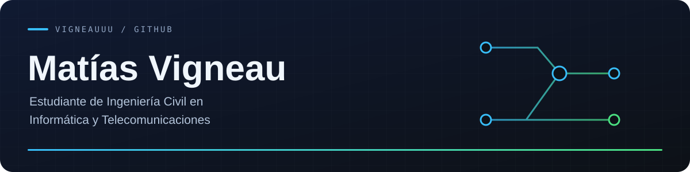
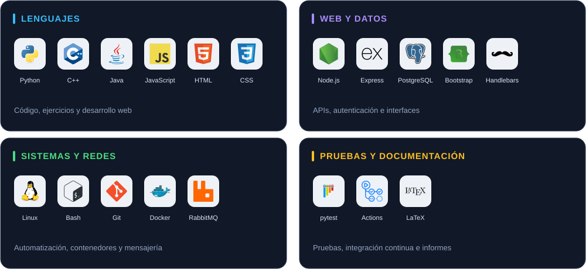

  

  <a href="https://github.com/vigneauuu?tab=repositories">Repositorios</a>
  &nbsp;·&nbsp;
  <a href="mailto:nicolassvigneau@gmail.com">Contacto</a>

## Tecnologías

  

## DNS protector

**[Caracterización de servicios DNS y perfiles de protección →](https://github.com/vigneauuu/Practica_DNS_VPN)**

Proyecto en desarrollo para estudiar cómo responden distintos servicios de DNS protector. Incluye un corpus documentado, consultas controladas y análisis reproducibles.

<code>Python</code> <code>DNS</code> <code>pytest</code>

---

<strong>Otros trabajos académicos</strong>

### Desarrollo web

- [API de tienda](https://github.com/vigneauuu/Entrega3WEB): backend con Node.js, Express, PostgreSQL y autenticación JWT.
- [Interfaz de tienda](https://github.com/vigneauuu/Entrega4WEB): catálogo, carrito y administración conectados a una API.

### Laboratorios

- [Mensajería AMQP](https://github.com/vigneauuu/RabbitMQ): envío, recepción y observación de mensajes con RabbitMQ, Python y Docker.
- [Seguridad y autenticación](https://github.com/vigneauuu/lab3-criptografia-mobileread): análisis documentado de hashes y autenticación.
- [Criptografía — laboratorio 2](https://github.com/vigneauuu/Lab2-Criptografia): comparación de respuestas HTTP en una instancia local de DVWA.
- [Criptografía — laboratorio 1](https://github.com/vigneauuu/Lab1-Criptografia): archivo de evidencias.

### Ejercicios de programación

- [Programación UDP](https://github.com/vigneauuu/ProgramacionUdp): C++, Java, estructuras de datos y desarrollo web.

